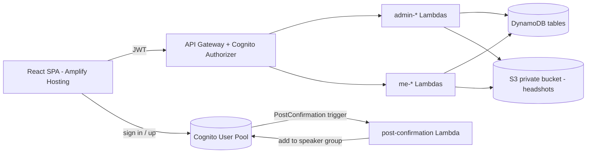

# Design Document

## Overview

The Toolkit is a serverless web app for one organising group. It reuses the existing stack (React + Vite + Amplify Hosting, API Gateway, Lambda on Node 22 built with esbuild, DynamoDB, Cognito, SAM) and replaces the Meetup/LinkedIn domain with CFPs, speakers and events.

Guiding decisions:

- **Roles via Cognito groups.** Two groups: `admin` and `speaker`. The role is read server-side from the `cognito:groups` claim in the verified token (Req 1.9).
- **Admin-only data lives in separate storage.** The Marker, admin notes, review notes and ratings are stored in tables that speaker-facing handlers never read. A leak to speakers is then structurally impossible rather than relying on field filtering (Req 5.4, 8.12).
- **Separate speaker and admin API surfaces.** Routes are namespaced `/admin/*` and `/me/*`, and each handler enforces its group before doing anything else.
- **Small number of Lambdas, one per domain**, each with a tiny internal router, to keep SAM verbose-ness down.
- **Single place for the product name** (`frontend/src/config/app.ts`).

## Architecture



### Backend modules (`src/`)

| Path | Responsibility |
|---|---|
| `handlers/post-confirmation.ts` | Cognito trigger: adds every self-signed-up user to the `speaker` group |
| `handlers/users.ts` | `/admin/users` invite and promote admins; `/me` returns identity and role |
| `handlers/events.ts` | Event CRUD (admin), speaker view of confirmed bookings |
| `handlers/speakers.ts` | Profiles: `/me/profile`, `/admin/speakers`, marker endpoints, headshot upload URLs |
| `handlers/cfps.ts` | CFP CRUD, questions, templates (admin), open CFP list and detail (speaker) |
| `handlers/submissions.ts` | Speaker submit, draft, edit, withdraw; admin review, rating, status |
| `handlers/bookings.ts` | Booking CRUD with warning checks |
| `shared/auth.ts` | Extract identity and groups from event, `requireAdmin`, `requireSpeaker` |
| `shared/http.ts` | Response helpers, error types, JSON body parsing, router |
| `shared/validation.ts` | Pure validators for each entity (used by handlers and tests) |
| `shared/repos/*.ts` | DynamoDB access per entity |
| `shared/models.ts` | Entity TypeScript types |

Existing `shared/aws-clients.ts`, `shared/utils.ts`, `shared/middleware.ts` and `shared/config.ts` are kept where still relevant and pruned of dead code.

### Frontend modules (`frontend/src/`)

```
config/app.ts              APP_NAME and other branding constants (single source)
contexts/AuthContext.tsx   Adds role, groups and view flags from ID token groups
components/common/         Layout, RequireRole route guard, form controls
components/admin/          EventCalendar, EventForm, SpeakerDirectory, SpeakerDetail,
                           CfpList, CfpForm, QuestionBuilder, TemplateManager,
                           SubmissionList, SubmissionReview, BookingPanel, UserAdmin
components/speaker/        ProfileForm, OpenCfps, SubmissionForm, MySubmissions, MyBookings
services/api.ts            Typed API client (adds Authorization header)
types/                     Shared frontend types
```

`index.html` title is set from `APP_NAME` at build via a Vite `transformIndexHtml` plugin (Req 12.2). Everything else imports `APP_NAME` directly.

## Authentication and authorisation

- **Sign-up:** Cognito self sign-up stays enabled. A PostConfirmation trigger adds the user to the `speaker` group. No path through public sign-up can yield `admin` (Req 1.2, 1.3).
- **Admin bootstrap:** a one-off documented CLI step adds the first user to the `admin` group (`aws cognito-idp admin-add-user-to-group`). After that, admins manage admins in the UI.
- **Promote (Req 1.4):** `POST /admin/users/{userId}/promote` calls `AdminAddUserToGroup(admin)`. The user keeps the `speaker` group too, so one person can be both. Role routing prefers `admin`.
- **Invite (Req 1.5):** `POST /admin/users/invite` calls `AdminCreateUser` (Cognito emails a temporary password) then adds to `admin`.
- **Revoke:** `POST /admin/users/{userId}/demote` removes the `admin` group. An admin cannot demote themselves, so the group can never be left with no admins.
- **Server enforcement:** every handler starts with `requireAdmin(event)` or `requireSpeaker(event)`. The API Gateway authorizer rejects unauthenticated calls with 401 (Req 1.8). Wrong role returns 403 (Req 1.7). The group claim is only read from `requestContext.authorizer.claims`.
- **Frontend:** `RequireRole` guards routes. This is UX only; the server is the authority. After login, `admin` routes to `/admin`, else `/speaker` (Req 1.6); `role` (admin over speaker) only decides that default. `AuthContext` also exposes `groups`, `canUseSpeakerView` and `canUseAdminView` from the ID token `cognito:groups`, and `RequireRole` admits a user whose groups include the required role, so an admin who is also in the `speaker` group can open `/speaker/*` to fill in a CFP, while an admin outside that group or a speaker on `/admin` is still redirected. `Layout` picks the nav from the area (path prefix) and shows a Viewing as label with a Speaker view / Admin view switch link only to users who can use both. Server side, `requireSpeaker` and `requireAdmin` check the group list, so a user in both groups passes both.
- **Token claim note:** group changes take effect after the user's next token refresh. The UI forces `fetchAuthSession({ forceRefresh: true })` after a promote.

The existing API Gateway `CognitoAuthorizer` is kept. CORS `AllowOrigin '*'` is tightened to the Amplify domain via a template parameter.

## Data model

DynamoDB, on-demand billing. IDs are UUID v4 strings. All items carry `createdAt`, `createdBy`, `updatedAt`, `updatedBy` (Req 11.6) in ISO-8601 UTC.

### Tables

**EventsTable** (`eventId`)
- Attributes: `title`, `startDateTime`, `endDateTime`, `location`, `isOnline`, `description`, `format`, `status` (`draft|scheduled|completed|cancelled`). Events do not reference CFPs.
- GSI `StatusDateIndex`: PK `status`, SK `startDateTime` (filter by status and date range, Req 2.5). The calendar view uses a scan with a date filter, which is fine at this scale (hundreds of events).

**SpeakersTable** (`speakerId`) – speaker-visible profile
- Attributes: `userId?` (Cognito sub, absent for admin-created profiles), `name`, `bio`, `headshotKey?`, `location`, `topics[]`, `links[]`, `pastTalks[]`
- GSI `UserIdIndex`: PK `userId` (look up own profile).

**SpeakerAdminTable** (`speakerId`) – admin-only
- Attributes: `marker?` (`have_back|not_again`), `markerNote?`, `markerChangedBy`, `markerChangedAt`, `adminNotes?`
- Only `admin-*` code paths import the repo for this table. Speaker handlers have no IAM permission on it (see IAM below).

**CfpsTable** (`cfpId`)
- Attributes: `title`, `description`, `opensAt?`, `closesAt?`, `status` (`draft|open|closed`), `questions[]` (embedded, ordered). Both dates are optional. A CFP with no `closesAt` is a standing CFP that stays open until an admin closes it. There is no CFP-to-event link: bookings reference an event and (optionally) a submission, and any `eventId` left on an older item is ignored and never written back.
- Questions are embedded in the CFP item because they are always read together and a CFP will have tens of them at most. Each question: `{ questionId, type, label, helpText?, required, options?[], order }`.
- GSI `StatusIndex`: PK `status`, SK `closesAt`. Left unchanged in `template.yaml` (changing keys would replace the deployed table). A GSI only indexes items that have its range key, so standing CFPs (no `closesAt`) never appear in it. `cfpsRepo.listByStatus` therefore scans the table and filters by `status` instead of querying the index (the table holds a handful of CFPs), sorting by `closesAt` with standing CFPs last. The index is retained but unused by the code. The speaker open-CFP list (Req 8.1) and the admin list both use this.

**QuestionTemplatesTable** (`templateId`)
- Attributes: `name`, `questions[]`. Applying a template deep-copies questions with new `questionId`s into the CFP (Req 7.7).

**SubmissionsTable** (`submissionId`)
- Attributes: `cfpId`, `speakerId`, `status` (`draft|submitted|shortlisted|accepted|rejected|withdrawn`), `talkTitle`, `abstract`, `durationMinutes`, `answers` (map `questionId -> { questionLabel, questionType, value }`)
- Answers snapshot the label and type so a deleted or edited question leaves the answer readable (Req 7.9).
- GSI `CfpIndex`: PK `cfpId`, SK `createdAt`.
- GSI `SpeakerIndex`: PK `speakerId`, SK `createdAt`.

**SubmissionReviewsTable** (PK `submissionId`, SK `adminUserId`) – admin-only
- Attributes: `rating` (1 to 5), `notes`. One item per admin so ratings are stored separately and averaged on read (Req 9.7).

**BookingsTable** (`bookingId`)
- Attributes: `eventId`, `speakerId`, `submissionId?`, `status` (`proposed|confirmed|declined`), `speakerNameSnapshot`
- GSI `EventIndex`: PK `eventId`. GSI `SpeakerIndex`: PK `speakerId`, SK `createdAt`.
- `speakerNameSnapshot` allows anonymisation when a speaker deletes their account while keeping event history (Req 11.5).

### Headshots

Private S3 bucket (`HeadshotsBucket`, public access blocked). Flow: client asks `POST /me/profile/headshot-url` with content type and size, server validates (JPEG/PNG/WebP, at most 5 MB, Req 3.5) and returns a presigned PUT URL with `content-length-range` conditions via presigned POST. Profile responses include a short-lived (15 min) presigned GET URL (Req 11.4). Key format: `headshots/{speakerId}/{uuid}`.

## API

All routes require a valid JWT. "A" = admin, "S" = speaker.

| Method and path | Role | Purpose |
|---|---|---|
| GET `/me` | any | Identity and role |
| GET, PUT `/me/profile` | S | Own profile (Req 3) |
| POST `/me/profile/headshot-url` | S | Presigned upload |
| DELETE `/me` | S | Delete account and data (Req 11.5) |
| GET `/me/cfps`, GET `/me/cfps/{id}` | S | Open CFPs, with questions |
| GET, POST `/me/submissions`; GET, PUT, DELETE `/me/submissions/{id}` | S | Own submissions; DELETE withdraws |
| POST `/me/submissions/{id}/submit` | S | draft to submitted |
| GET `/me/bookings` | S | Confirmed bookings only (Req 10.8, 10.9) |
| GET, POST `/admin/events`; GET, PUT, DELETE `/admin/events/{id}` | A | Events |
| GET, POST `/admin/speakers`; GET, PUT `/admin/speakers/{id}` | A | Directory and detail |
| PUT `/admin/speakers/{id}/marker` | A | Set marker, note |
| PUT `/admin/speakers/{id}/notes` | A | Admin notes |
| POST `/admin/speakers/{id}/link` | A | Link to account (Req 3.7) |
| GET, POST `/admin/cfps`; GET, PUT, DELETE `/admin/cfps/{id}` | A | CFPs. Body: `{ title, description?, opensAt?, closesAt?, status? }`. Send `closesAt: null` or `''` on PUT to clear it. No `eventId`. Responses include `effectiveStatus`; `closesAt` is absent for standing CFPs. `GET /me/cfps` returns the same without audit fields. |
| POST `/admin/cfps/{id}/duplicate` | A | Req 6.8 |
| PUT `/admin/cfps/{id}/questions` | A | Replace ordered question list |
| GET, POST, DELETE `/admin/templates`; POST `/admin/cfps/{id}/apply-template` | A | Req 7.6 |
| GET `/admin/cfps/{id}/submissions`; GET `/admin/submissions/{id}` | A | Review list and detail |
| PUT `/admin/submissions/{id}/status` | A | Status change |
| PUT `/admin/submissions/{id}/review` | A | Own rating and notes |
| GET, POST `/admin/bookings`; PUT, DELETE `/admin/bookings/{id}` | A | Bookings. POST accepts `confirmWarnings: true` |
| GET, POST `/admin/users`; `/admin/users/{id}/promote`, `/demote` | A | User and admin management |

### Warning pattern

Marker, double-booking and overlap checks (Req 5.5, 5.7, 10.5, 10.6) are soft. `POST /admin/bookings` without `confirmWarnings` returns `409` with `{ warnings: [{code, message}] }` when any apply. The client shows them and resubmits with `confirmWarnings: true`. Codes: `SPEAKER_NOT_AGAIN`, `DUPLICATE_BOOKING`, `OVERLAPPING_EVENT`. Same pattern applies to deleting an event with bookings, a CFP with submissions, and a question on a CFP with submissions (Req 2.8, 6.7, 7.8): `409 CONFIRM_REQUIRED`.

## Key behaviours

**CFP effective status.** `effectiveStatus(cfp, now)` is `'open'` when `cfp.status === 'open'`, `now >= cfp.opensAt` (or there is no `opensAt`) and `now < cfp.closesAt` (or there is no `closesAt`, which means the CFP stays open until an admin closes it). Otherwise it is `'draft'` for a draft and `'closed'` for anything else. This pure function is the single place that decides openness and is used for listing and for submit/edit validation (Req 6.5, 8.1, 8.7, 8.10).

**Submission validation** (`validateSubmission(cfp, input, mode)`), a pure function:
- `mode = draft`: only type-checks provided values.
- `mode = submit`: also requires `talkTitle`, `abstract`, `durationMinutes` and all required questions (Req 7.10, 8.5).
- Select answers must be in the question's `options` (Req 8.6). Unknown `questionId`s are rejected. Number questions must be finite numbers; yes/no must be booleans.

**Speaker edit rules.** Speakers can edit or withdraw their submission while the CFP is effectively open. A speaker's edit to a `shortlisted` or `accepted` submission resets nothing silently: editing is blocked once status is `accepted`, `rejected`, or `shortlisted` (the speaker sees a "contact the organisers" message). This is an assumption beyond the requirements and is easy to relax.

**Speaker-facing status mapping (Req 8.12).** Statuses map as `draft -> Draft`, `submitted|shortlisted -> Under review`, `accepted -> Accepted`, `rejected -> Not selected`, `withdrawn -> Withdrawn`. Shortlisting is therefore not revealed to speakers.

**Marker audit (Req 5.3).** The marker endpoint writes `markerChangedBy` and `markerChangedAt` in the same update as the marker.

**Account deletion (Req 11.5).** In order: delete submissions and review items for the speaker's submissions, delete headshot object, replace `speakerId`-linked booking `speakerId` with `null` (keeping `speakerNameSnapshot` replaced by "Former speaker"), delete `SpeakersTable` and `SpeakerAdminTable` items, then delete the Cognito user. Each step is idempotent so a retry after partial failure is safe.

**Event deletion cascade (Req 2.9).** Deletes bookings for the event, after confirmation. CFPs are not touched, so `EventsFunction` has no policy on `CfpsTable`.

**Drawing speakers from any CFP (Req 10.3, 10.4, 10.10).** The event page lists accepted submissions from every CFP, grouped and labelled by CFP title with a CFP filter, each with a Book action. Accepting a submission offers an event picker (upcoming, non-cancelled events) and the existing `confirmWarnings` flow. `POST /admin/bookings` only checks that the submission belongs to the speaker, never that its CFP matches the event, so one submission can be booked onto several events.

**Event and CFP date validation.** `endDateTime >= startDateTime` and `closesAt > opensAt` (only when both are given), enforced in `shared/validation.ts` (Req 2.7, 6.4).

## Error handling

- Handlers return a uniform body `{ error: { code, message, fields? } }`.
- `400 VALIDATION_ERROR` with `fields` (map of field to message) for validation failures, `401` and `403` from auth, `404 NOT_FOUND`, `409 CONFIRM_REQUIRED` or booking warnings, `500 INTERNAL` (details logged, not returned).
- A speaker requesting another speaker's resource gets `404`, not `403`, to avoid confirming existence (Req 11.2).
- DynamoDB conditional writes guard against lost updates on submissions and CFPs via an `updatedAt` condition; a mismatch returns `409 CONFLICT`.
- The frontend API client maps these to form-level and field-level messages.

## IAM and infrastructure changes (`template.yaml`)

- **Remove:** `ScheduledPostsTable`, `MessagesTable`, `NotificationsTable`, `SyncRecordsTable`, `SyncConflictsTable`, `UsersTable`, `SchedulerQueue`, `SyncScheduleRule`, `PostScheduleRule`, the Social, Messaging, Notification, Sync, LinkedIn, and Scheduler functions, their permissions, and the LinkedIn parameters and environment variables.
- **Add:** the tables above, `HeadshotsBucket`, the `admin` and `speaker` `AWS::Cognito::UserPoolGroup`s, the PostConfirmation function and its Cognito `LambdaConfig`, and an `AllowedOrigin` parameter.
- **Least privilege:** speaker-facing functions (`me` routes) get no policy on `SpeakerAdminTable` or `SubmissionReviewsTable`. Because routes for both roles live in the same domain Lambda (for example `submissions.ts`), they are split into two functions per domain where admin-only tables are touched: `submissions-admin` and `submissions-me`, `speakers-admin` and `speakers-me`. Other domains use a single function.
- Cognito `UserPoolClient` keeps SRP and refresh flows. `ALLOW_USER_PASSWORD_AUTH` is removed because the app uses SRP.

## Frontend behaviour

- **Event calendar:** a lightweight month grid component written in-house (no calendar library) plus a list view with status and date filters. Chosen to avoid a heavy dependency for a simple month view.
- **Question builder:** an ordered list with add, edit, delete and up/down reorder buttons (keyboard-accessible; drag and drop is not required). Saving sends the whole ordered list. Type-specific editors for options. A confirmation dialog appears when the API returns `CONFIRM_REQUIRED`.
- **Submission form:** rendered dynamically from the CFP's question list, with a "Save draft" and "Submit" action, and inline per-field errors from the `fields` map.
- **Marker UI:** a segmented control (Have back / Not again / None) with a note field on the speaker detail page, and badges in the directory and the review list. `not_again` uses a text label as well as colour (accessibility).
- **Accessibility:** all forms use labelled controls, error text linked via `aria-describedby`, and focus is moved to the first error on failed submit.

## Legacy removal

Delete: frontend `LinkedInAuth`, `LinkedInCallback`, `SocialMediaScheduler`, `MessagingCenter`, `NotificationCenter`, `Dashboard`, `EventForm`, `EventList` (rewritten), `mockData.ts`, `README-AUTH.md` content on LinkedIn, and their tests. Backend: LinkedIn, Meetup, messaging, notification, social-media, sync, scheduler handlers and services, and their `tests/*`. Compiled artefacts in `tests/` (`*.js`, `*.d.ts`, `*.map`) are removed and ignored. `landing/`, `BLOG-POST.md`, `BUGS.md` and the old `logimeet` spec are reviewed during the cleanup task and removed if they describe the dead product (confirmed with the user first). Package names `eventpush-*` are renamed to a neutral placeholder.

## Testing strategy

The repo already uses Jest on both sides. Tests for new code focus on logic that is pure and risky:

- **Unit tests:** `validation.ts` (events, CFPs, questions, submissions), `effectiveStatus`, status mapping, overlap detection, warning generation, `requireAdmin`/`requireSpeaker`.
- **Property tests** (the repo already contains `*.property.test.ts` files; reuse whichever property library it uses): validation never accepts an answer that is not in the options; the speaker-facing response shaping never emits marker, notes or review fields for arbitrary inputs; overlap detection is symmetric; applying a template then editing the template leaves the CFP unchanged.
- **Handler tests** with mocked DynamoDB for authorisation: every `/admin/*` route returns 403 for speaker tokens, and every `/me/*` route cannot read another speaker's data.
- **Frontend tests:** `RequireRole` redirects, `QuestionBuilder` add/reorder/validation, `SubmissionForm` required-field handling, and that `APP_NAME` is the only source of the product name (a test greps `src` for the literal placeholder outside `config/app.ts`).
- **Infrastructure test:** the existing `infrastructure.test.ts` is updated to assert no legacy resources remain and that speaker functions have no policy on admin-only tables.

## Requirement coverage

| Requirement | Main design elements |
|---|---|
| 1 Auth | Cognito groups, PostConfirmation trigger, `shared/auth.ts`, `RequireRole` |
| 2 Events | EventsTable, `events.ts`, calendar and list components |
| 3, 4 Profiles, directory | SpeakersTable, headshots bucket, `speakers-*`, directory components |
| 5 Marker | SpeakerAdminTable, marker endpoint, warning pattern |
| 6, 7 CFPs, questions | CfpsTable with embedded questions, templates table, QuestionBuilder |
| 8 Submissions | SubmissionsTable, `validateSubmission`, `effectiveStatus`, status mapping |
| 9 Review | SubmissionReviewsTable, review endpoints |
| 10 Bookings | BookingsTable, warning pattern, speaker confirmed-only view |
| 11 Integrity | Route-level role checks, 404 for foreign resources, signed URLs, deletion flow |
| 12 App name | `config/app.ts`, Vite HTML transform |
| 13 Legacy removal | Legacy removal section, template.yaml changes, doc updates |
